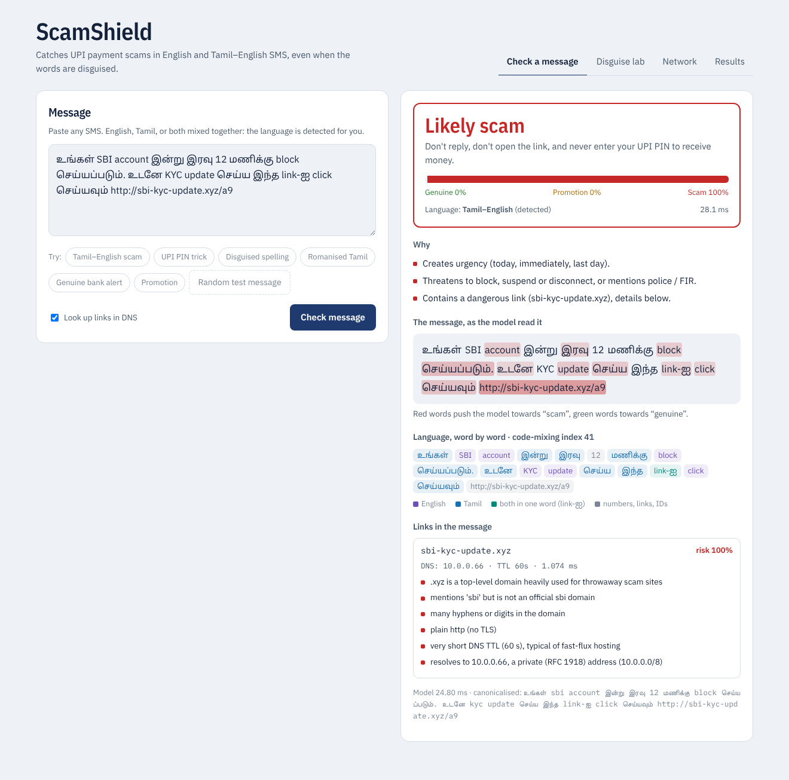
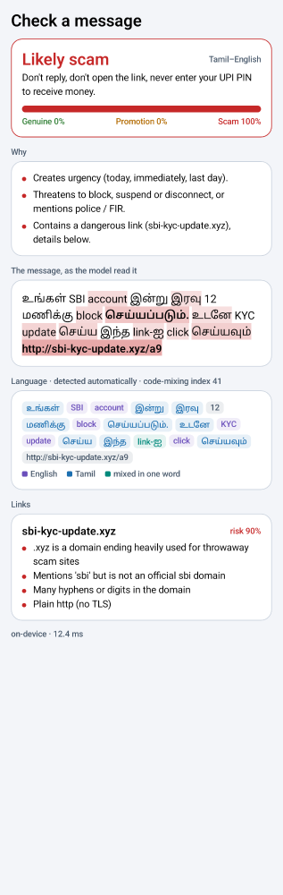
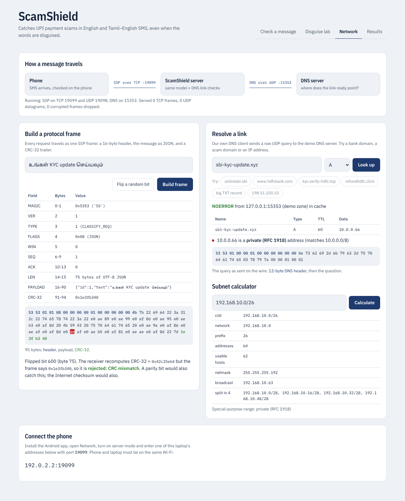
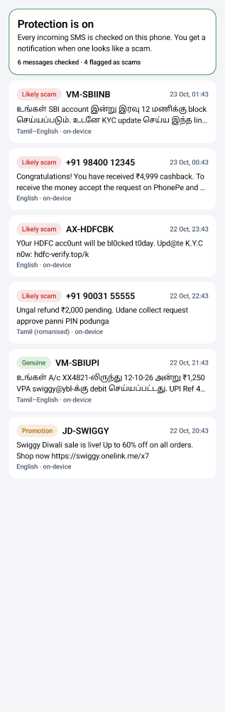

# ScamShield — Robust Detection of UPI Payment Scams in Bilingual (Tamil–English) SMS, as a Networked System

Computer Networks project (BCSE308L / BCSE308P), VIT Vellore.
Shreyans Chowdry (24BDS0114) · Ayushmaan Nayak (public-dataset integration)

Payment scams arrive as SMS written in English or in Tamil mixed with English
(`உங்கள் SBI account இன்று block செய்யப்படும். உடனே KYC update செய்ய link-ஐ click செய்யவும்`), and scammers disguise
the words that filters look for: `P1N`, `K.Y.C`, a Cyrillic `е` in `rеfund`, Tamil digits that look like letters,
invisible characters, or whole words switched into the other script. ScamShield has three parts:

1. **A detector and a benchmark.** UPI-BiSMS is a bilingual SMS corpus (English and Tamil–English in Tamil script)
   with a graded disguise scheme (L0–L4, including transliteration). Twelve classifiers are evaluated on it,
   along with three defences. Real public SMS corpora are used to check how well the results carry over.
2. **A networked service.** The detector is served over our own CRC-protected protocol (SSP) on TCP and UDP. The UDP
   path has Go-Back-N / Selective Repeat reliability and AIMD congestion control. A DNS client and server written
   from raw UDP packets, plus CIDR analysis, check where every link in a message really points. Every network
   mechanism is measured.
3. **An Android app.** It reads every incoming SMS, checks it on the phone, and notifies you when it looks like a
   scam. It can also send messages to the server over SSP.

See `paper/CN_MAPPING_AND_NOVELTY.md` for how each part maps to the CN theory and lab syllabus, and for the
novelty statement.

```
   SMS ──► Android app ──(on-device model)──► notification
               │
               └── SSP frames over TCP :9099 ──► ScamShield server ──► canonicalise → char n-gram model
                                                     │                         + link intelligence
                                                     └── DNS over UDP :5353 ──► DNS server (A/AAAA/CNAME/PTR)
                                                                                 + CIDR checks of the answers
```

## Quick start (macOS / Linux)

```bash
./setup.sh        # one time: creates .venv and installs requirements
./run_demo.sh     # web app on http://localhost:8000, SSP on TCP 9099 / UDP 9098, DNS on 5353
```

The web app has four tabs:
* **Check a message**: the verdict, the reasons, the words that drove it, the language of each word (detected
  automatically), and every link with its DNS answer.
* **Disguise lab**: disguise a scam step by step and watch where each model gives up.
* **Network**: build an SSP frame and flip a bit to watch the CRC catch it, resolve links with our DNS client,
  use the subnet calculator, and find the address to connect the phone to.
* **Results**: every figure and table.

**Android:** install `releases/ScamShield.apk` on any Android 8+ phone (details in `android/README.md`).

## Command-line tools

```bash
source .venv/bin/activate; export PYTHONPATH=src
python -m scamshield.net.service --tcp 9099 --udp 9098 --dns 5353          # the server on its own
python -m scamshield.net.client tcp  "உங்கள் KYC update செய்ய link-ஐ click செய்யவும் bit.ly/x"
python -m scamshield.net.client udp  "Your refund is pending, enter UPI PIN"
python -m scamshield.net.client batch messages.txt --arq sr --window 8       # reliable batch over UDP
python -m scamshield.net.client ping --count 10                              # RTT over TCP
python -m scamshield.net.client dns  sbi-kyc-update.xyz                      # our DNS client
python -m scamshield.net.client dns  198.51.100.10 --type PTR                # reverse lookup
```

## Reproducing everything

```bash
bash scripts/run_all.sh                      # all experiments (transformers take hours on CPU)
SKIP_TRANSFORMERS=1 bash scripts/run_all.sh  # everything except the transformers (~1.5 h on a laptop)
PYTHONPATH=src python -m pytest -q tests     # 14 tests: data, obfuscation, CRC, Hamming, SSP, CIDR, DNS, ARQ
cd android && ./gradlew testDebugUnitTest    # the phone's model matches the Python model exactly
```

Every run is cached in `results/runs/` (shipped zipped as `results/runs.zip`), so the pipeline can be resumed.

| Path | Contents |
|---|---|
| `data/upi_bisms.csv` | the bilingual dataset (`text, label, subtype, lang, template_id, split`) |
| `data/public/` | public SMS corpora: Mishra & Soni, UCI, ExAIS, translated multilingual UCI |
| `results/RESULTS.md` | every table in one file |
| `results/tables/`, `results/figures/` | tables (CSV) and figures (PNG + PDF) for the paper |
| `artifacts/production.joblib` | the detector used by the web app and the server |
| `paper/METHODS.md`, `paper/FINDINGS.md` | the method and the results, written to be lifted into the paper |
| `android/` | the Android app (Kotlin / Jetpack Compose) |

## Code map

```
src/scamshield/
  data/templates.py      parallel English / Tamil–English message templates (23 intents)
  data/generator.py      builds UPI-BiSMS with a template-disjoint split
  data/public.py         public SMS corpora loaders (one schema, de-duplicated, grouped splits)
  tamil.py               Tamil script tools: loanwords, transliteration, confusable letters
  langid.py              automatic word-by-word language identification, code-mixing index
  obfuscation.py         L0–L4 disguise operators + script-aware canonicalisation
  models/                word / char TF-IDF models, BiGRU, char CNN, transformers
  detector.py            the production detector (+ export to the phone)
  experiments.py         experiment stages; analysis.py → tables and figures
  net/protocol.py        SSP frame format (header, CRC-32), TCP stream reassembly
  net/errorcodes.py      parity, Internet checksum, CRC-16, CRC-32, Hamming(7,4)
  net/arq.py             Stop-and-Wait, Go-Back-N, Selective Repeat, RTO estimation, AIMD
  net/channel.py         impaired-link emulator (loss, bursts, bit errors, delay, bottleneck)
  net/dns.py             DNS client and server on raw UDP (+TCP fallback, cache, PTR)
  net/cidr.py            IPv4/IPv6, classful/classless addressing, special-purpose ranges
  net/urlintel.py        link intelligence: lexical + DNS + CIDR
  net/service.py         TCP and UDP servers; net/client.py clients; net/experiments.py N1–N6
app/                     FastAPI web app (also starts the network services)
android/                 Android app
scripts/                 run_all.sh, train_production.py
```

## Results

Full write-up: `paper/FINDINGS.md`. Every table: `results/RESULTS.md`.

**Detector** (template-disjoint test set, macro-F1, L0 = clean, L4 = cross-script transliteration; uniform = every message disguised):

| Model | Clean | L4 (uniform) | Scams missed, clean → L4 (targeted) | CPU ms / message |
|---|---|---|---|---|
| Word LR | 0.785 | 0.666 | 12.9% → 23.4% | 0.6 |
| Char LR | 0.777 | 0.713 | 13.2% → 12.9% | 0.8 |
| XLM-R | **0.851** | 0.677 | 7.4% → 30.7% | 150 |
| MuRIL | 0.749 | 0.746 | 7.7% → 27.6% | 115 |
| CANINE-S | 0.778 | 0.615 | 12.3% → 17.7% | 155 |
| **ScamShield production** (char + canonicalisation + public data) | 0.792 | 0.789 (targeted) | 15.3% → 17.7% | ~1 |

* **Character models degrade less than word and subword models.** This held in 10 of 12 paired tests for the classical and neural models, and in all 4 tests of Char LR vs XLM-R (paired bootstrap, p < 0.01).
* **Cross-script transliteration (L4) is the strongest attack.** Some pretrained models (DistilmBERT, CANINE-S) learn to treat any disguise as a scam and start flagging disguised genuine messages.
* **Synthetic-only and public-only training both fail on the other side's data.** Joint training works on both: UPI-BiSMS 0.78 / 0.74 (English / Tamil–English), real smishing 0.87.
* **Network:**
  * CRC-32 caught 100% of corrupted frames; a parity bit missed about 50% of bursts.
  * At 10% packet loss, Selective Repeat's efficiency is 0.82 against Go-Back-N's 0.53.
  * AIMD avoids the collapse that a fixed 48-frame window causes at a bottleneck (129 vs 74 messages/s).
  * A cached DNS lookup takes 0.14 ms against 20.7 ms over the network.
* **Phone app:** gives the same answers as the Python model (0 differences on 300 messages, max probability difference 7×10⁻⁷).

| Web app | Android app |
|---|---|
|  |  |
|  |  |

## Note on the data

UPI-BiSMS is synthetic. Its templates were written from publicly reported UPI scam patterns and real bank/UPI
message formats. That makes controlled experiments possible, but it does not replace real SMS. The test split is
template-disjoint, and the public-corpus experiments measure how far results carry over to real messages.
